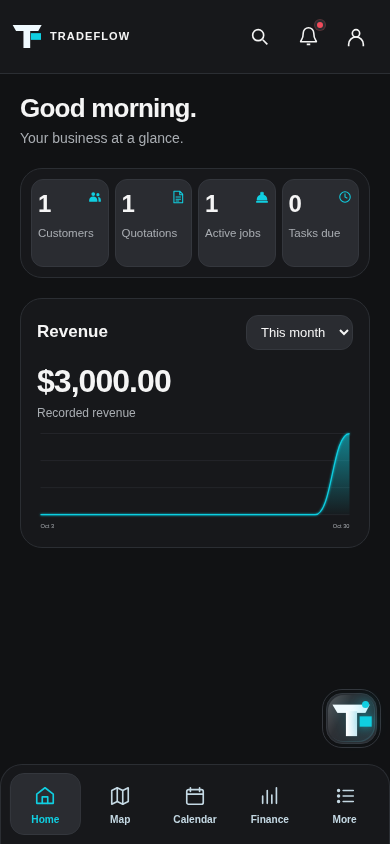
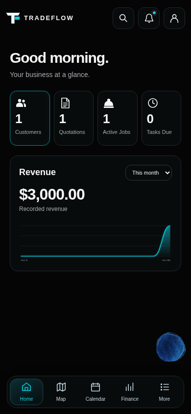

# Founder Home visual correction

Actual Chromium app captures at360/390/430 and desktop1280, with the existing synthetic contractor fixture. Before is GUI16c191f; after is this scoped GUI increment. Same viewport390, fixture, time and period for the before/after; recorded $3,000 is fixture data, not a hardcoded chart or live business evidence. Empty-state capture is separately identified.

| Before390 | Corrected390 |
| --- | --- |
|  |  |

The supplied target has now been visually reviewed directly: near-black canvas, individually outlined header controls, separate dark metric tiles, white icons above values, slim Revenue treatment and floating dock. Both marked sections remain absent. No annotations or decorative wave are added to Home.

CSS ownership: graphite-theme.css owns Home tokens/cards/header; fluid-navigation.css owns enhanced dock geometry/material; legacy style.css footer rules explicitly target the static fallback. The old compact/grey metric rules and duplicate workspace header overrides were removed. No new !important declarations were introduced in these owned styles; the orb owner's existing CSS is consumed verbatim.

PR29 source296164f: intelligence-orb-idle.js and CSS plus its geometry/source tests are copied without renderer/art edits; mesh/click host integration stays on the existing button. The persistent button's old T decoration is removed; the original header/panel brand remains. Canvas-unavailable fallback is labeled as unavailable rather than presented as a verified mesh. PR29 itself is untouched; its founder acceptance is not inferred.

Remaining deviations/gates: the reference's former glass orb is intentionally replaced by the separate mesh owner's candidate, whose final artwork remains founder-review pending. Revenue curves, values and dates follow actual records/periods rather than copying the target's $0 example or future dates. Greeting remains time-aware. Native font rendering, physical iPhone safe-area/VoiceOver and real-device performance need review; Chromium widths, keyboard, reduced motion, 200% text/page zoom, offline and source routes are covered by retained tests. Screenshots are evidence of this implementation, not founder visual sign-off. No merge/deployment.
